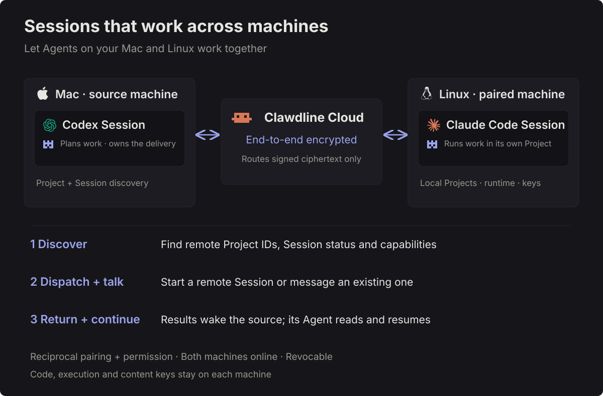

# Clawdline

[繁體中文](README.zh-TW.md) · [Security](https://clawdline.com/security/)

[](LICENSE)
[](go.mod)

**With Clawdline Cloud, see Claude Code and Codex Sessions across your machines in one phone list, then open one to reply or leave a to-do.**

One continuous recording of the real console with sample data:


[Herdr](https://github.com/herdrdev/herdr/blob/master/docs/versions/0.9.1/website/src/content/docs/connecting-machines.mdx) also lists agents across SSH machines in one TUI; [T3 Code](https://github.com/pingdotgg/t3code/blob/main/docs/user/remote-access.md) connects to multiple environments. Clawdline Cloud groups them in a phone browser list and opens their conversations, to-dos, and images there.

## What you can do

- **Follow Sessions:** See what is working or waiting, read the conversation, view pictures from Agents, and reply with text, voice, or a marked-up picture. [Sessions](docs/user/sessions.md)
- **Keep work moving:** Leave [to-dos](docs/user/board.md#session-to-dos), answer [Agent notes](docs/user/sessions.md#attention-notes-from-agents), and get [notifications](docs/user/notifications.md).
- **Work in a terminal:** Open a live [terminal](https://clawdline.com/docs/shells/#terminals) beside your Sessions.
- **Delegate and track delivery:** [Dispatch](docs/user/clawdfather-and-dispatch.md) to another Session, verify that its work landed, and follow larger work on the optional [Board](docs/user/board.md).
- **Run work later:** Queue long commands with [callbacks](docs/user/clawdfather-and-dispatch.md#callbacks-for-long-commands) or start tasks with [schedules](docs/user/schedules.md). Cloud Pro adds webhook triggers.
- **Bring your projects together:** [Register projects](docs/user/projects.md), share rules and skills across Claude Code and Codex with [unify](docs/project-files.md#unify), and see [usage](docs/user/usage.md).
- **See every machine:** [Clawdline Cloud](docs/user/remote-access.md) shows Sessions from multiple machines together on your phone and connects through an end-to-end encrypted relay.
- **Connect directly from your phone:** When ICE can reach your machine, live Terminal and Session reads use a direct WebRTC data channel. The encrypted relay remains available when direct connection fails. [Cloud connection](docs/cloud.md)

Clawdline runs the daemon and console on your machine and works with Claude Code and Codex Sessions you already use. Cloud is optional; its relay carries encrypted data. [How it works](docs/architecture.md)

## Sessions that work across machines (Cloud)

Let Codex on your Mac work with Claude Code on Linux. After reciprocal pairing, Agents can discover remote Projects and Sessions, dispatch work to a chosen Project, message an existing Session, and resume when results return. You do not have to copy instructions and replies between machines.



Both machines must be online and authorize the connection. Work runs on the target machine; code and content keys stay on your hardware. Pairing is revocable, and task completion does not mean changes have landed. **Available in dev builds today**; the release installer does not yet include the new discovery and Session wake-up features. [Usage and authority boundaries](docs/remote-agent-work.md)

## A direct path from your phone to your machine (Cloud)

For a paired phone, Clawdline first tries to open a direct WebRTC data channel to your Mac or Linux machine for live Terminal and Session reads. This removes the relay hop from those reads and can make the Terminal feel more responsive. Cloud still carries connection signalling and other commands; if ICE cannot connect directly, the end-to-end encrypted relay carries the reads instead.


The machine can turn direct connections off in Settings → Remote or with `clawdline cloud direct off`. An AWS Linux host can bind ICE to one UDP port; see [the Cloud guide](docs/cloud.md#aws-linux-direct-connection) and [the full Linux procedure](docs/linux.md#let-a-cloud-browser-connect-directly-to-ec2). Fixed-port setup is currently in development builds.

## Security and your data

Clawdline reads your Claude Code and Codex conversations, terminals and project files on your own machine. Local use needs no account, and Cloud stays off until you turn it on.

With Cloud on, content is encrypted on your machine before it leaves. Cloud relays ciphertext without the keys to decrypt it; only your machine and the browsers you pair can read it. Cloud still sees account, device and traffic metadata.

A paired browser can send instructions and use your terminal, so pair only devices you trust. Claude Code and Codex still send requests to their AI providers under those providers' policies.

[How it works, with diagrams and source links](https://clawdline.com/security/) · [AI security review comparison](https://clawdline.com/ai-review/)

## Install

[](https://github.com/sainteye/clawdline/releases/download/v2.2.0/Clawdline-v2.2.0-macos-arm64.dmg)

Apple Silicon · macOS 13+ · [Install guide](https://clawdline.com/docs/install/#mac-dmg)

For the command-line installer on macOS 13+ or Linux, install Claude Code or Codex, trusted Python 3, and OpenSSL 3 or newer. The macOS bundled LibreSSL is not sufficient; see [verification prerequisites](docs/user/install.md#before-you-start). Then run:

```sh
curl -fsSL https://clawdline.com/install.sh | sh
```

Before unpacking or executing downloaded code, the installer uses local OpenSSL to verify the manifest against public keys pinned in the reviewed script, then checks the archive against its signed size and SHA-256. Missing verification tools or failed checks stop the installation. You still need to trust the installer script and your local tools. The verified program then starts a per-user service and opens the console. Start a Session there or run `claude` or `codex` in tmux; the release includes tmux if needed. [Install and first run](docs/user/install.md) · [First Session](docs/user/first-session.md)

The short URL points to a reviewed verifier script and installs the latest stable release. The script revision and the installed release are separate; the signed release manifest names the program source revision. The entry point can change as reviewed installers are promoted. [Review and pin an installation](docs/user/install.md#review-and-pin-an-installation) keeps the fixed-script, fixed-version alternative and explains the first-install trust boundary.

## Availability

- Local use is free and needs no Clawdline account. Cloud offers Free and Pro plans.
- Windows runs the daemon and console but cannot yet list Sessions or open terminals. [Platforms](docs/user/platforms.md)
- Version 1.0 and later can update macOS and Linux release installs in place. The console supports nine languages, with English fallback for newer untranslated copy. [Updates](docs/updates.md) · [Localization](docs/localization.md)

## Guides

[User guide](docs/user/README.md) · [Agent guide](docs/agent-contract.md) · [Build from source](docs/user/install.md) · [Troubleshooting](docs/user/troubleshooting.md) · [Developer docs](docs/README.md) · [UI motion catalog](docs/ui-motion-catalog.md) · [Static HTML reports](docs/html-artifacts.md)

## License

[MIT](LICENSE)
