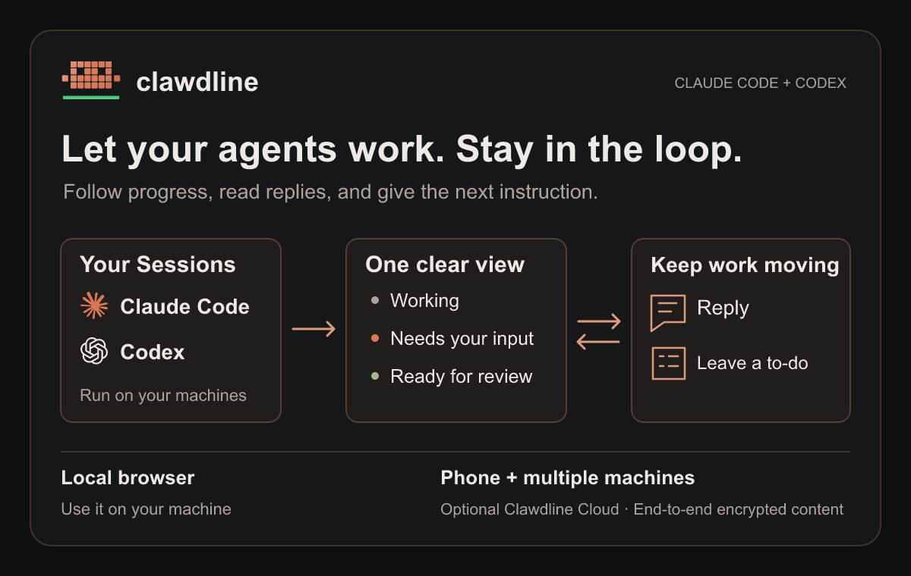
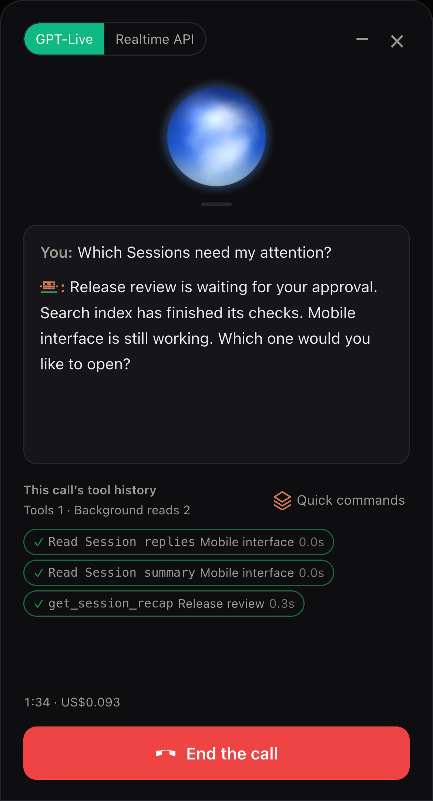
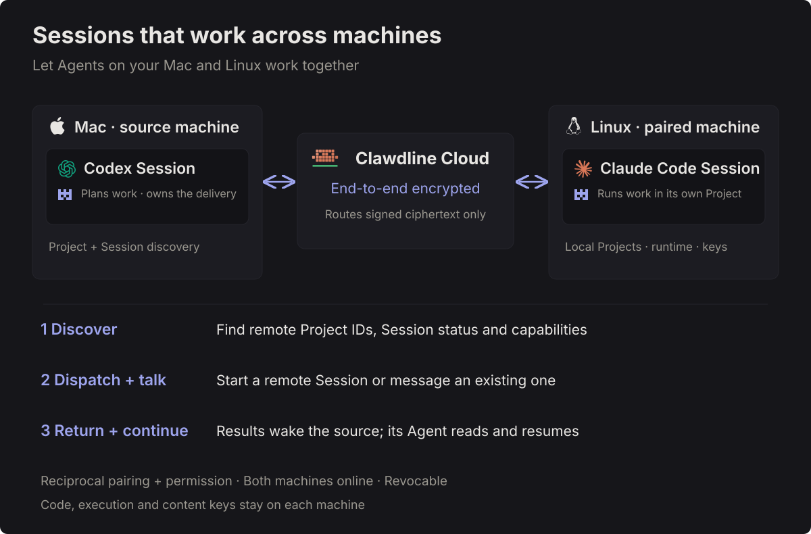
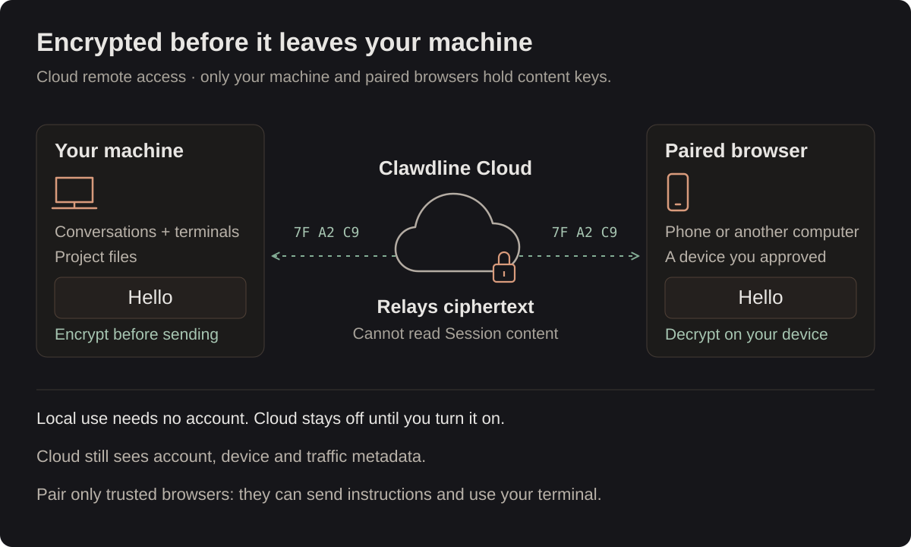

# Clawdline

🌐 **[Clawdline website](https://clawdline.com/)** — See how Clawdline brings Claude Code and Codex Sessions together, download the app, and explore setup guides and security details.

[繁體中文](README.zh-TW.md) · [Security](https://clawdline.com/security/)

[](LICENSE)
[](go.mod)

**Clawdline brings your Claude Code and Codex Sessions and your long-lived Bots onto one platform, and gives you a voice copilot you can call to hear what needs you.**



### 🧩 Sessions and Bots on one platform

**Sessions** are the Claude Code and Codex conversations you already run. **Bots** are long-lived assistants bound to a Project: they remember what you tell them, work with their agent's own tools, and hand larger changes to an isolated worker through Clawdline's Broker, the same path Sessions use to dispatch work, with the result returning to the same chat. Both live in one console, beside the terminal, the optional Board and notifications. Bots currently run on macOS. [Sessions](docs/user/sessions.md) · [Bots](docs/bots.md)

### 🎙️ A voice copilot for your Sessions

Call the voice copilot to hear what needs you, ask about a Session's progress or a message board's current Lead, and open the relevant conversation. It reads the full recipient and message back for your agreement before sending. Green capsules keep the call's tool activity, with quick commands beside them and duration and amount below.

<a href="https://clawdline.com/docs/voice-copilot/"></a>

*Current Cloud/dev interface with synthetic example data. Voice calls use your own OpenAI API key.*

[Voice copilot guide and demo](https://clawdline.com/docs/voice-copilot/) · [Desktop video (1:51)](https://media.clawdline.com/voice-copilot/demo-en-d2857cd36962.mp4) · [Phone video (1:55)](https://media.clawdline.com/voice-copilot/demo-en-phone-21cfaf2e686a.mp4). Recorded GPT-Live calls with fictional Sessions and prerecorded AI user speech; on-screen amounts are examples. The call sheet stays open for 30 seconds before shrinking to a floating bubble.

### 🏙️ Your Bots live in a tower


Switch Bots to the tower view and every Project gets a floor of a pixel-art building, beside the same Bot list. The whole building shows every floor at once, and the elevator takes you to one. Working Bots sit at desks, waiting ones queue, failing ones go to the repair corner, idle ones stroll the lounge, and Bots quiet for a day go to sleep. A New reply badge marks unread replies, and selecting a Bot opens its chat while the floor keeps running. [The Bots tower](docs/bots.md#the-bots-tower)

*Synthetic example Bots, recorded from the console.*

### 🏮 Lantern Deep: watch your Sessions as a game


Install the Lantern Deep view and pin it beside the Session list: every Project becomes a hand-painted underground chamber, every Session one of twelve frame-by-frame animated wanderers. A working wanderer fights, one that needs you stands puzzled under a warm beacon, and finished work rests or sleeps by the campfire. A life bar shows how much context is still free. Select a wanderer to open its Session. Lantern Deep is an experimental View Plugin offered under Explore views. [Lantern Deep](plugins/session-lantern-deep/README.md) · [View Plugins](docs/plugins/view-plugin-v1.md)

*Synthetic example Sessions, recorded from the console.*

## How Clawdline differs from Herdr and T3 Code

- 🖥️ **Herdr — a desktop app for terminals and coding agents.** Keep work in spaces, see which agents need you, and leave terminals running on local and SSH machines through herdr-core. An agent can start helpers and hear back. Native apps for macOS, Windows and Linux, phone apps for iPhone, iPad and Android, a separate TUI, and a community gallery of layouts and mods. [Herdr](https://herdr.dev/) · [Desktop app](https://github.com/herdrdev/herdr-app#readme) · [herdr-core](https://github.com/herdrdev/herdr-core#readme)
- 💬 **T3 Code — an open-source control plane for coding agents.** Drive Claude Code, Codex, Cursor, OpenCode and other ACP agents through desktop, web and mobile apps, connect other machines over T3 Connect, LAN, Tailscale or SSH, and let one agent delegate a task to another. [T3 Code overview](https://github.com/pingdotgg/t3code#readme) · [Remote access](https://github.com/pingdotgg/t3code/blob/main/docs/user/remote-access.md)
- 🔁 **Clawdline — Sessions and Bots in one place, with a voice copilot.** Bring your existing Claude Code and Codex Sessions and long-lived Project Bots into one browser console. Call the voice copilot to hear what needs you, and follow the work as a Bots tower or in a game view such as Lantern Deep. Leave to-dos, answer Agent notes, dispatch work, and track verification, merge and deployment on the optional Board; a delivery report and a verified Git landing stay distinct. Cloud adds one phone list across machines. [Sessions](docs/user/sessions.md) · [Bots](docs/bots.md) · [Voice copilot](docs/user/voice-copilot.md) · [Board](docs/user/board.md)

## What you can do

### Follow your Agents

- 🤖 **All your Sessions in one place** — See which Claude Code and Codex Sessions are working or waiting, then open a conversation to follow along. [Sessions](docs/user/sessions.md)
- 💬 **Reply with text, voice or pictures** — Dictate a message, attach a screenshot, or circle what needs changing before sending it. Open pictures from Agents right in the conversation. [Messages and pictures](docs/user/sessions.md#answer-and-send)
- 🖥️ **A live terminal beside your Sessions** — Run commands from the console without switching to another terminal app. [Terminals](https://clawdline.com/docs/shells/#terminals)
- 📌 **Agent notes you can act on** — Keep questions, suggested replies and requests to review something above the conversation, ready when you return. [Attention notes](docs/user/sessions.md#attention-notes-from-agents)
- 🔔 **Notifications when work needs you** — Enable alerts for waiting Sessions, deliveries, Board decisions and schedule failures, with links back to the work. [Notifications](docs/user/notifications.md)
- 📊 **Token use and account quotas** — Inspect a Session's context and token use, see task and Board token bills, and check provider quota windows when readings are available. [Usage](docs/user/usage.md)

### Turn requests into delivered work

- ☑️ **To-dos without interrupting a turn** — Leave the next task in a Session's queue for the Agent to pick up when it checks its work. [Session to-dos](docs/user/board.md#session-to-dos)
- 🗂️ **A Board from idea to deployment** — Track proposals, plans, implementation, verification, merge and deployment. Assign work to a Session and see what needs your decision. The Board is optional. [Board](docs/user/board.md)
- 🤝 **Delegate to another Session** — Dispatch a bounded task, get its result back, and check whether the changes actually landed. [Dispatch](docs/user/clawdfather-and-dispatch.md)
- 📖 **Playbook for repeatable work** — Save complete launch messages for reviews and other recurring tasks. Agents can manage them with `clawdline playbook list|create|edit|delete`. [Playbook API and CLI guide](docs/playbooks.md#agent-api) · `clawdline guide project`
- 🧩 **Shared rules and skills** — Use unify to make project instructions and skills available to both Claude Code and Codex. [Unify](docs/project-files.md#unify)
- 📁 **Projects and worktrees together** — Register projects, start Sessions in the right directory, and inspect worktrees, delivered work and landed changes. [Projects](docs/user/projects.md)

### Keep work moving away from your desk

- 📱 **Your machines in one phone list (Cloud)** — Open Sessions from multiple machines in a paired browser, read conversations, reply and leave to-dos. Cloud is optional. [Remote access](docs/user/remote-access.md)
- 🌐 **Agents working across machines (Cloud · dev)** — After reciprocal pairing, let Agents discover remote Projects and Sessions, dispatch tasks and exchange messages. The new discovery and Session wake-up features are currently in dev builds. [Cross-machine work](docs/remote-agent-work.md)
- ⚡ **A direct phone connection (Cloud)** — Live Terminal and Session reads use WebRTC when ICE can connect directly; the end-to-end encrypted relay carries them when it cannot. [Cloud connection](docs/cloud.md)
- ⏳ **Long commands with a return notice** — Hand a command to a callback and let the Session resume when its result is ready. [Callbacks](docs/user/clawdfather-and-dispatch.md#callbacks-for-long-commands)
- 🗓️ **Scheduled tasks and webhook triggers** — Start work at a chosen time or on a recurring schedule. Through Cloud, external services can also trigger a schedule with a webhook. [Schedules](docs/user/schedules.md)
- 💡 **A place for questions, Issues and Ideas (Cloud)** — Read community discussions, ask usage questions, report problems and propose features. Anyone can read; participation requires sign-in. Answers and delivery progress are tracked separately. [Community guide](docs/user/help-center.md) · [Publication boundaries](docs/cloud-support.md)

Clawdline runs the daemon and console on your machine and works with Claude Code and Codex Sessions you already use. Cloud is optional; its relay carries encrypted data. [How it works](docs/architecture.md)

Official [Grok Build coding Sessions](docs/grok-cli.md) also support native file edits, tool approvals and worktree dispatch after CLI sign-in.

## Sessions that work across machines (Cloud)

Let Codex on your Mac work with Claude Code on Linux. After reciprocal pairing, Agents can discover remote Projects and Sessions, dispatch work to a chosen Project, message an existing Session, and resume when results return. You do not have to copy instructions and replies between machines.



Both machines must be online and authorize the connection. Work runs on the target machine; code and content keys stay on your hardware. Pairing is revocable, and task completion does not mean changes have landed. **Available in dev builds today**; the release installer does not yet include the new discovery and Session wake-up features. [Usage and authority boundaries](docs/remote-agent-work.md)

## A direct path from your phone to your machine (Cloud)

For a paired phone, Clawdline first tries to open a direct WebRTC data channel to your Mac or Linux machine for live Terminal and Session reads. This removes the relay hop from those reads and can make the Terminal feel more responsive. Cloud still carries connection signalling and other commands; if ICE cannot connect directly, the end-to-end encrypted relay carries the reads instead.


The machine can turn direct connections off in Settings → Remote or with `clawdline cloud direct off`. An AWS Linux host can bind ICE to one UDP port; see [the Cloud guide](docs/cloud.md#aws-linux-direct-connection) and [the full Linux procedure](docs/linux.md#let-a-cloud-browser-connect-directly-to-ec2). Fixed-port setup is currently in development builds.

## Security and your data

Clawdline reads your Claude Code and Codex conversations, terminals and project files on your own machine. Local use needs no account, and Cloud stays off until you turn it on.



With Cloud on, content is encrypted on your machine before it leaves. Cloud relays ciphertext without the keys to decrypt it; only your machine and the browsers you pair can read it. Cloud still sees account, device and traffic metadata.

A paired browser can send instructions and use your terminal, so pair only devices you trust. Claude Code and Codex still send requests to their AI providers under those providers' policies.

[How it works, with diagrams and source links](https://clawdline.com/security/) · [AI security review comparison](https://clawdline.com/ai-review/)

## Install

[](https://github.com/sainteye/clawdline/releases/download/v3.2.0/Clawdline-v3.2.0-macos-arm64.dmg)

Apple Silicon · macOS 13+ · [Install guide](https://clawdline.com/docs/install/#mac-dmg)

For the command-line installer on macOS 13+ or Linux, install Claude Code or Codex, trusted Python 3, and OpenSSL 3 or newer. The macOS bundled LibreSSL is not sufficient; see [verification prerequisites](docs/user/install.md#before-you-start). Then run:

```sh
curl -fsSL https://clawdline.com/install.sh | sh
```

Before unpacking or executing downloaded code, the installer uses local OpenSSL to verify the manifest against public keys pinned in the reviewed script, then checks the archive against its signed size and SHA-256. Missing verification tools or failed checks stop the installation. You still need to trust the installer script and your local tools. The verified program then starts a per-user service and opens the console. Start a Session there or run `claude` or `codex` in tmux; the release includes tmux if needed. [Install and first run](docs/user/install.md) · [First Session](docs/user/first-session.md)

The short URL points to a reviewed verifier script and installs the latest stable release. The script revision and the installed release are separate; the signed release manifest names the program source revision. The entry point can change as reviewed installers are promoted. [Review and pin an installation](docs/user/install.md#review-and-pin-an-installation) keeps the fixed-script, fixed-version alternative and explains the first-install trust boundary.

## Availability

- Clawdline is free. Local use needs no Clawdline account; Cloud needs sign-in and is free too.
- Windows runs the daemon and console but cannot yet list Sessions or open terminals. [Platforms](docs/user/platforms.md)
- Version 1.0 and later can update macOS and Linux release installs in place. The console supports nine languages, with English fallback for newer untranslated copy. [Updates](docs/updates.md) · [Localization](docs/localization.md)

## Guides

[User guide](docs/user/README.md) · [Agent guide](docs/agent-contract.md) · [Build from source](docs/user/install.md) · [Troubleshooting](docs/user/troubleshooting.md) · [Developer docs](docs/README.md) · [Local CodeGraph](docs/codegraph-integration.md) · [UI motion catalog](docs/ui-motion-catalog.md) · [Static HTML reports](docs/html-artifacts.md) · [API performance priorities](docs/performance/local-api-review-2026-11-08.md) · [Three API optimizations](docs/performance/api-round-two-2026-11-08.md)

[Experimental View Plugins](docs/plugins/view-plugin-v1.md) load independent ZIP views at runtime. Packages are stored per browser/interface; the included Galaxy and List read explicitly scoped Session summaries. Public Release availability depends on the installed host version.

## Bots architecture and acknowledgments

Clawdline's **Bots architecture draws on [Codync](https://github.com/leepokai/Codync)**, including persistent Bot identity, per-Bot message queues, memory, and native agent session boundaries. Clawdline adapts these concepts to its Go daemon and React console. We thank the Codync authors and contributors for their work.

See the [reuse and architecture reference](docs/project-assistants-reuse.md), [adaptation record](third_party/codync/DERIVATION.md), and preserved [license](third_party/codync/LICENSE) and [attribution notice](third_party/codync/NOTICE).

## License

[MIT](LICENSE)
