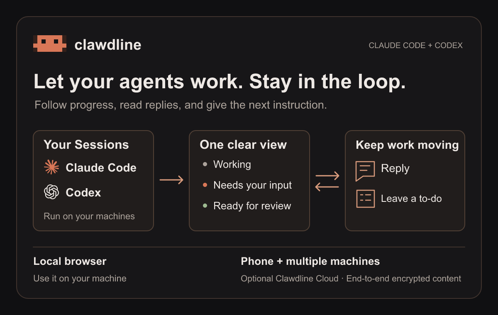
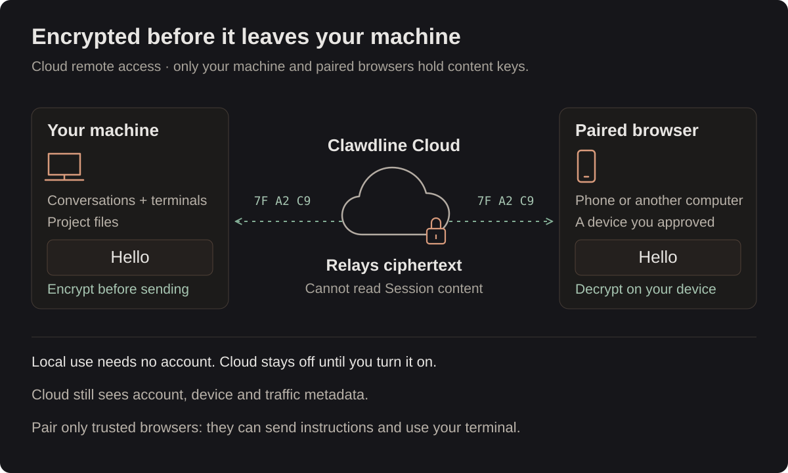

# Clawdline

🌐 **[Clawdline website](https://clawdline.com/)** — See how Clawdline brings Claude Code and Codex Sessions together, download the app, and explore setup guides and security details.

[繁體中文](README.zh-TW.md) · [Security](https://clawdline.com/security/)

[](LICENSE)
[](go.mod)

**With Clawdline Cloud, see Claude Code and Codex Sessions across your machines in one phone list, then open one to reply or leave a to-do.**



## How Clawdline differs from Herdr and T3 Code

- 🖥️ **Herdr — a terminal workspace for Agents.** Run Agents in persistent terminal panes, with local and SSH workspaces together in one TUI. [Herdr overview](https://github.com/herdrdev/herdr#readme) · [Connecting machines](https://herdr.dev/docs/connecting-machines/)
- 💬 **T3 Code — an app for working with coding Agents.** Control Agents through desktop, web and mobile apps, including local and remote environments. [T3 Code overview](https://github.com/pingdotgg/t3code#readme) · [Remote access](https://github.com/pingdotgg/t3code/blob/main/docs/user/remote-access.md)
- 🔁 **Clawdline — coordinate Sessions and track delivery.** Bring your existing Claude Code and Codex Sessions into a browser console. Leave to-dos, answer Agent notes, dispatch work, and track verification, merge and deployment on the optional Board. A delivery report and a verified Git landing stay distinct. Cloud adds one phone list across machines. [Sessions](docs/user/sessions.md) · [Dispatch](docs/user/clawdfather-and-dispatch.md) · [Board](docs/user/board.md)

## What you can do

### Follow your Agents

- 🤖 **All your Sessions in one place** — See which Claude Code and Codex Sessions are working or waiting, then open a conversation to follow along. [Sessions](docs/user/sessions.md)
- 💬 **Reply with text, voice or pictures** — Dictate a message, attach a screenshot, or circle what needs changing before sending it. Open pictures from Agents right in the conversation. [Messages and pictures](docs/user/sessions.md#answer-and-send)
- 🖥️ **A live terminal beside your Sessions** — Run commands from the console without switching to another terminal app. [Terminals](https://clawdline.com/docs/shells/#terminals)
- 📌 **Agent notes you can act on** — Keep questions, suggested replies and requests to review something above the conversation, ready when you return. [Attention notes](docs/user/sessions.md#attention-notes-from-agents)
- 🔔 **Notifications when work needs you** — Enable alerts for waiting Sessions, deliveries, Board decisions and schedule failures, with links back to the work. [Notifications](docs/user/notifications.md)
- 📊 **Token use and account quotas** — Inspect a Session's context and token use, see task and Board token bills, and check provider quota windows when readings are available. [Usage](docs/user/usage.md)

### Turn requests into delivered work

- ☑️ **To-dos without interrupting a turn** — Leave the next task in a Session's queue for the Agent to pick up when it checks its work. [Session to-dos](docs/user/board.md#session-to-dos)
- 🗂️ **A Board from idea to deployment** — Track proposals, plans, implementation, verification, merge and deployment. Assign work to a Session and see what needs your decision. The Board is optional. [Board](docs/user/board.md)
- 🤝 **Delegate to another Session** — Dispatch a bounded task, get its result back, and check whether the changes actually landed. [Dispatch](docs/user/clawdfather-and-dispatch.md)
- 📖 **Playbook for repeatable work** — Save complete launch messages for reviews and other recurring tasks. Agents can manage them with `clawdline playbook list|create|edit|delete`. [Playbook API and CLI guide](docs/playbooks.md#agent-api) · `clawdline guide project`
- 🧩 **Shared rules and skills** — Use unify to make project instructions and skills available to both Claude Code and Codex. [Unify](docs/project-files.md#unify)
- 📁 **Projects and worktrees together** — Register projects, start Sessions in the right directory, and inspect worktrees, delivered work and landed changes. [Projects](docs/user/projects.md)

### Keep work moving away from your desk

- 📱 **Your machines in one phone list (Cloud)** — Open Sessions from multiple machines in a paired browser, read conversations, reply and leave to-dos. Cloud is optional. [Remote access](docs/user/remote-access.md)
- 🌐 **Agents working across machines (Cloud · dev)** — After reciprocal pairing, let Agents discover remote Projects and Sessions, dispatch tasks and exchange messages. The new discovery and Session wake-up features are currently in dev builds. [Cross-machine work](docs/remote-agent-work.md)
- ⚡ **A direct phone connection (Cloud)** — Live Terminal and Session reads use WebRTC when ICE can connect directly; the end-to-end encrypted relay carries them when it cannot. [Cloud connection](docs/cloud.md)
- ⏳ **Long commands with a return notice** — Hand a command to a callback and let the Session resume when its result is ready. [Callbacks](docs/user/clawdfather-and-dispatch.md#callbacks-for-long-commands)
- 🗓️ **Scheduled tasks and webhook triggers** — Start work at a chosen time or on a recurring schedule. Cloud Pro also lets external services trigger a schedule through a webhook. [Schedules](docs/user/schedules.md)
- 💡 **A place for questions, Issues and Ideas (Cloud)** — Read community discussions, ask usage questions, report problems and propose features. Anyone can read; participation requires sign-in. Answers and delivery progress are tracked separately. [Community guide](docs/user/help-center.md) · [Publication boundaries](docs/cloud-support.md)

Clawdline runs the daemon and console on your machine and works with Claude Code and Codex Sessions you already use. Cloud is optional; its relay carries encrypted data. [How it works](docs/architecture.md)

## Sessions that work across machines (Cloud)

Let Codex on your Mac work with Claude Code on Linux. After reciprocal pairing, Agents can discover remote Projects and Sessions, dispatch work to a chosen Project, message an existing Session, and resume when results return. You do not have to copy instructions and replies between machines.


Both machines must be online and authorize the connection. Work runs on the target machine; code and content keys stay on your hardware. Pairing is revocable, and task completion does not mean changes have landed. **Available in dev builds today**; the release installer does not yet include the new discovery and Session wake-up features. [Usage and authority boundaries](docs/remote-agent-work.md)

## A direct path from your phone to your machine (Cloud)

For a paired phone, Clawdline first tries to open a direct WebRTC data channel to your Mac or Linux machine for live Terminal and Session reads. This removes the relay hop from those reads and can make the Terminal feel more responsive. Cloud still carries connection signalling and other commands; if ICE cannot connect directly, the end-to-end encrypted relay carries the reads instead.


The machine can turn direct connections off in Settings → Remote or with `clawdline cloud direct off`. An AWS Linux host can bind ICE to one UDP port; see [the Cloud guide](docs/cloud.md#aws-linux-direct-connection) and [the full Linux procedure](docs/linux.md#let-a-cloud-browser-connect-directly-to-ec2). Fixed-port setup is currently in development builds.

## Security and your data

Clawdline reads your Claude Code and Codex conversations, terminals and project files on your own machine. Local use needs no account, and Cloud stays off until you turn it on.



With Cloud on, content is encrypted on your machine before it leaves. Cloud relays ciphertext without the keys to decrypt it; only your machine and the browsers you pair can read it. Cloud still sees account, device and traffic metadata.

A paired browser can send instructions and use your terminal, so pair only devices you trust. Claude Code and Codex still send requests to their AI providers under those providers' policies.

[How it works, with diagrams and source links](https://clawdline.com/security/) · [AI security review comparison](https://clawdline.com/ai-review/)

## Install

[](https://github.com/sainteye/clawdline/releases/download/v2.9.0/Clawdline-v2.9.0-macos-arm64.dmg)

Apple Silicon · macOS 13+ · [Install guide](https://clawdline.com/docs/install/#mac-dmg)

For the command-line installer on macOS 13+ or Linux, install Claude Code or Codex, trusted Python 3, and OpenSSL 3 or newer. The macOS bundled LibreSSL is not sufficient; see [verification prerequisites](docs/user/install.md#before-you-start). Then run:

```sh
curl -fsSL https://clawdline.com/install.sh | sh
```

Before unpacking or executing downloaded code, the installer uses local OpenSSL to verify the manifest against public keys pinned in the reviewed script, then checks the archive against its signed size and SHA-256. Missing verification tools or failed checks stop the installation. You still need to trust the installer script and your local tools. The verified program then starts a per-user service and opens the console. Start a Session there or run `claude` or `codex` in tmux; the release includes tmux if needed. [Install and first run](docs/user/install.md) · [First Session](docs/user/first-session.md)

The short URL points to a reviewed verifier script and installs the latest stable release. The script revision and the installed release are separate; the signed release manifest names the program source revision. The entry point can change as reviewed installers are promoted. [Review and pin an installation](docs/user/install.md#review-and-pin-an-installation) keeps the fixed-script, fixed-version alternative and explains the first-install trust boundary.

## Availability

- Local use is free and needs no Clawdline account. Cloud offers Free and Pro plans.
- Windows runs the daemon and console but cannot yet list Sessions or open terminals. [Platforms](docs/user/platforms.md)
- Version 1.0 and later can update macOS and Linux release installs in place. The console supports nine languages, with English fallback for newer untranslated copy. [Updates](docs/updates.md) · [Localization](docs/localization.md)

## Guides

[User guide](docs/user/README.md) · [Agent guide](docs/agent-contract.md) · [Build from source](docs/user/install.md) · [Troubleshooting](docs/user/troubleshooting.md) · [Developer docs](docs/README.md) · [Graphify experiment](docs/experiments/graphify-local-pilot-2026-10-30.md) · [UI motion catalog](docs/ui-motion-catalog.md) · [Static HTML reports](docs/html-artifacts.md)

## License

[MIT](LICENSE)
